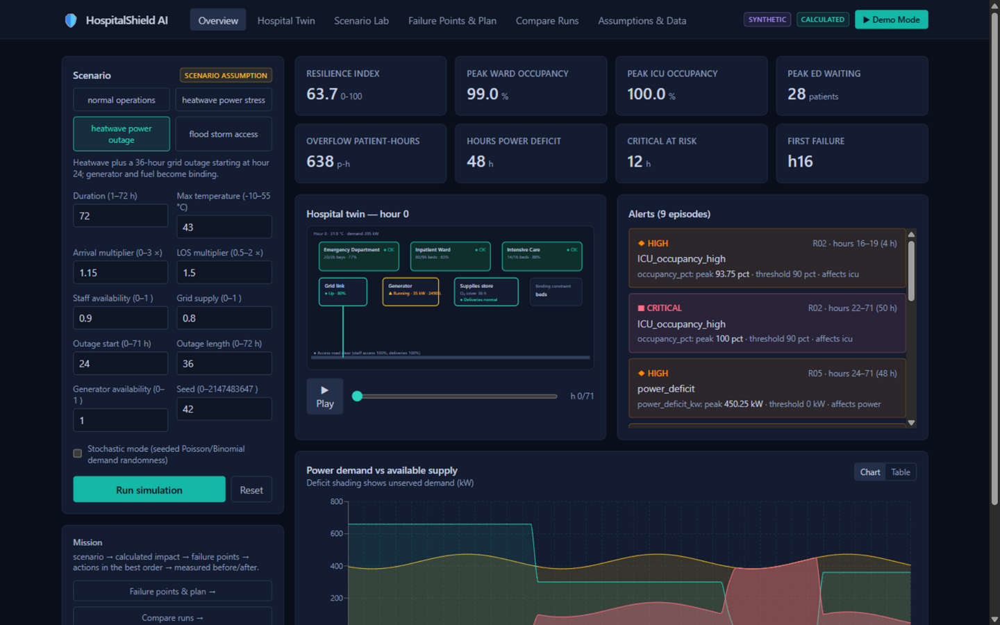
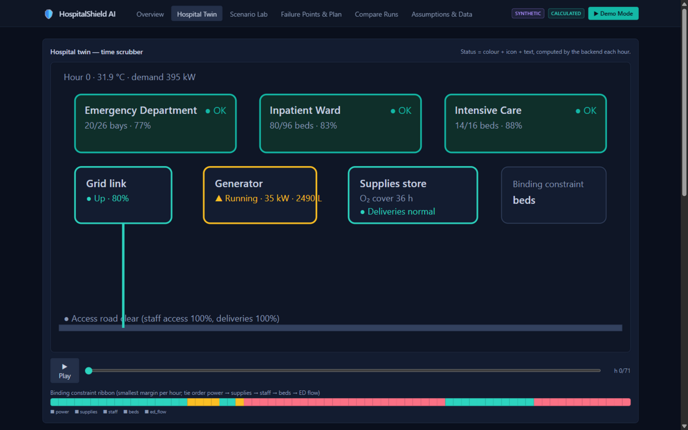
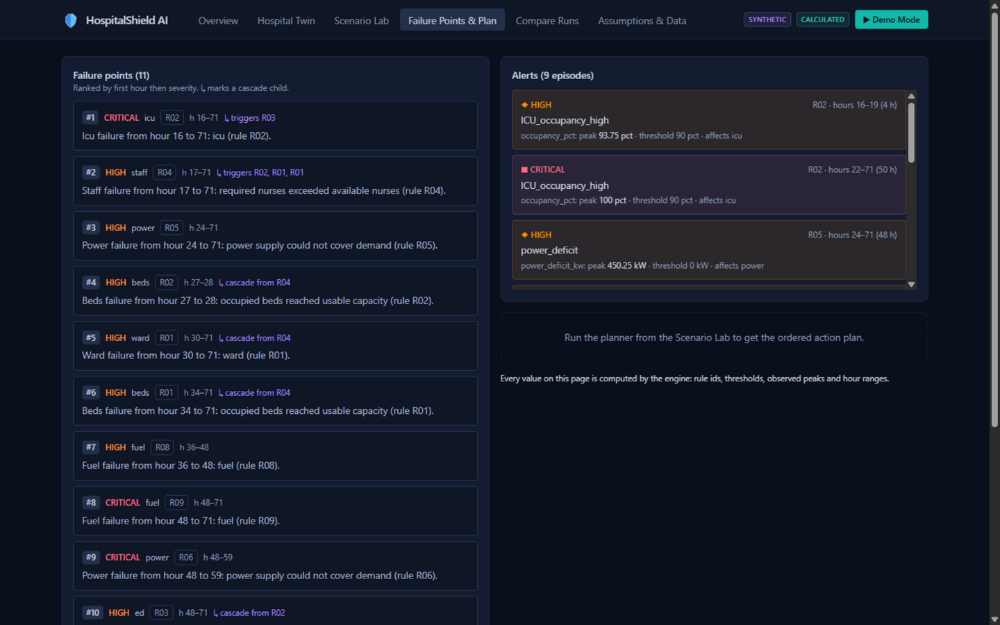
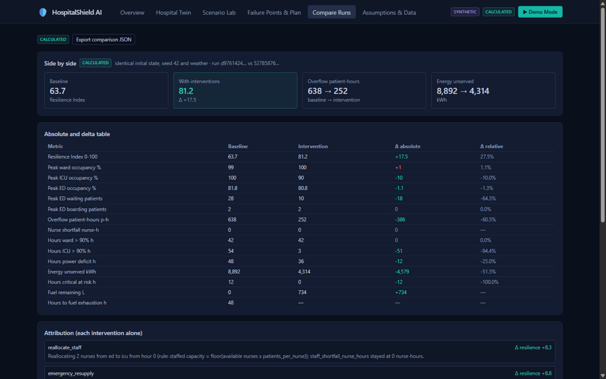
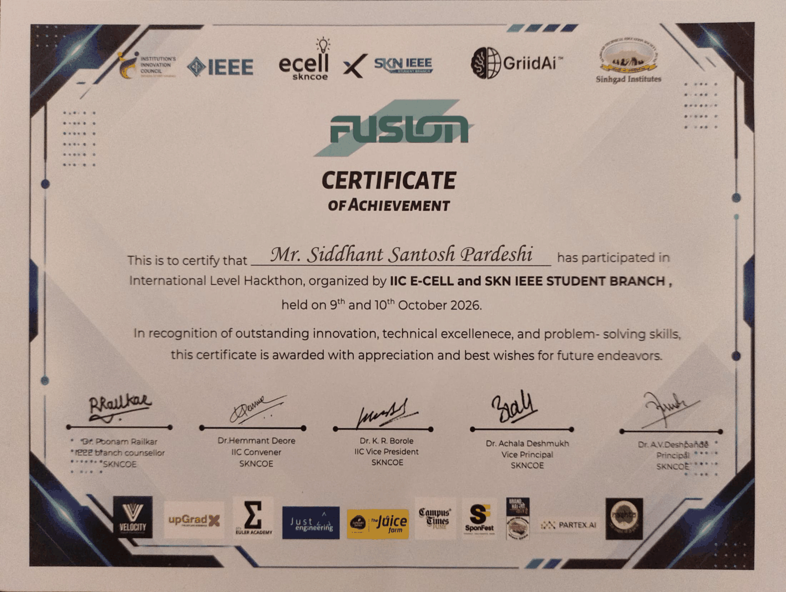

# HospitalShield AI

[](https://github.com/PratikRSonawane/HospitalShield-AI/actions/workflows/ci.yml)
[](LICENSE)
[](https://www.python.org/)
[](https://www.typescriptlang.org/)
[](docs/test-report.md)
[](#hackathon)

A climate-resilient hospital digital twin. Model a hospital's beds, staff, power, fuel, supplies and patient
flow, stress it with extreme-weather scenarios, watch which constraint binds first, and get an ordered,
feasible action plan — with a measured before/after comparison for every claim.

Built for hackathon problem **HC-03** (Mayo Clinic) at **FUSION 2026** — built in 24 hours, shortlisted
among the **Top 30 of 475 registered teams** for the final round: *extreme weather disrupts healthcare even
when the building stays intact*.

```
scenario ──▶ calculated operational impact ──▶ critical failure points
        ──▶ feasible interventions in the best order ──▶ measured before/after
```

> **What this is:** a planning prototype on synthetic (or your own uploaded) facility data.
> **What it is not:** a clinical, engineering-safety or live-operations system. Every screen says so.

---

## Demo video

A full working explanation of the project — problem, live walkthrough of the dashboard, failure-point
analysis, the planner and the measured before/after comparison:
**[Watch the walkthrough](https://drive.google.com/file/d/1bIPCsqnQbItrK3f8SSnXHScSxF_z5Z7r/view?usp=sharing)** (Google Drive, ~mp4).

## Screenshots

| Overview — Command Center | Hospital Twin |
|:---:|:---:|
|  |  |

| Failure Points & Action Plan | Compare Runs |
|:---:|:---:|
|  |  |

## The demo in numbers (heatwave + 36 h grid outage, 72 h horizon)

| Metric | Baseline | With planner's plan | Delta |
|---|---:|---:|---:|
| Resilience Index (0-100) | 63.7 | 81.2 | **+17.5** |
| Overflow patient-hours | 638 | 252 | **-386** |
| Energy unserved (kWh) | 8,892 | 4,314 | **-4,578** |

The plan the search found: request 2,016 L of emergency fuel at **hour 0** - it lands at hour 12, *before*
the access window closes; the same request made later delivers only a fraction through the disrupted road.
And move two nurses **ED -> ICU**, because the ICU is staff-capped and its surge beds are unusable until
staffing moves. Same seed, same weather, same starting state for both runs. That is what makes the
before/after honest.

---

## Quick start (under 5 minutes)

Requirements: Python 3.11+ and Node 18+.

```bash
# 1. backend
python -m venv .venv
.venv/Scripts/pip install -r requirements.lock.txt      # Linux/macOS: .venv/bin/pip
cd backend && ../.venv/Scripts/python -m uvicorn app.main:app --port 8000 &

# 2. frontend
cd frontend && npm install && npm run dev               # http://localhost:5173
```

Or with Docker:

```bash
docker compose up --build          # API on :8000, dashboard on :5173
```

The Overview page auto-runs the 72-hour heatwave-with-outage demo on load. For a fully offline demo, run
`make snapshots` once - it generates the precomputed fallback the dashboard loads if the API is unreachable
(marked **PRECOMPUTED**, editing disabled).

## The one loop that matters

1. **Scenario Lab** — pick a preset (heatwave stress, heatwave + grid outage, flood/storm access, or the
   normal-operations control), tune stress multipliers, add interventions, run.
2. **Failure Points & Plan** — ranked failure episodes with cascade parents, the binding-constraint ribbon,
   and traceable alerts (rule id, threshold, observed value, hour range). Hit the planner for an ordered
   action sequence with lead times and marginal gains.
3. **Apply plan → Compare** — same initial state, seed and weather; absolute deltas, per-intervention
   attribution, and "why it changed" explanations. On the outage preset the combined plan beats every single
   intervention — the app shows it, it doesn't claim it.

## Bring your own hospital

**Assumptions & Data → Bring your own hospital.** Download the template JSON, fill in your site's beds,
nurse rosters and ratios, electrical split (grid / critical / non-critical / generator / fuel), supplies and
thresholds, and upload it. The backend validates every parameter (rejecting impossible values with per-field
reasons), runs a 24-hour sanity check, and stores it as a selectable profile. Every scenario, plan and
comparison then runs on your hospital. The same schema works with the calibration scripts:

```bash
python backend/scripts/import_nhs_beds.py <downloaded-nhs.csv> <TRUST>   # open UK aggregate → reference JSON
python backend/scripts/calibrate_nhs.py data/reference/nhs_beds_<TRUST>.json
python backend/scripts/calibrate_from_mimic.py <local-extract.csv>       # your credentialed MIMIC-IV extract;
                                                                         # aggregates only, cells <10 suppressed
```

Dataset rules (MIMIC-IV is credentialed; NHS is open — both are references, never row-level, never runtime
data): [docs/data_sources.md](docs/data_sources.md).

## Repository layout

```
backend/
  app/simulation/     pure engine: config, scenario, power, staffing, supplies,
                      patient flow, alerts, metrics, failure points, invariants
  app/services/       comparison + attribution, beam-search planner, ensembles,
                      sensitivity, weather adapter, template explainer
  app/routers/        FastAPI endpoints (incl. hospital profile upload)
  tests/              1,133 tests: units, properties (hypothesis), 1,008-cell
                      scenario matrix, calibration acceptance, golden snapshots, API
  scripts/            demo snapshots, NHS/MIMIC calibration tooling
frontend/
  src/pages/          Overview, Hospital Twin, Scenario Lab, Failure Points & Plan,
                      Compare Runs, Assumptions & Data
  src/components/     hospital SVG map, charts with table alternatives, alert panel,
                      plan timeline, scenario controls, provenance badges
  src/types/api.ts    generated from backend openapi.json — never hand-written
data/                 demo hospital (SYNTHETIC), scenario presets, uploaded profiles
docs/                 assumptions, equations, api contract, data sources, model card
```

## Tests and quality gates

```bash
cd backend
../.venv/Scripts/python -m pytest tests/ --cov=app/simulation    # 1,133 passed; coverage ≥ 90%
../.venv/Scripts/python -m ruff check app tests scripts          # clean
../.venv/Scripts/python -m mypy                                  # strict, clean
cd ../frontend && npm test && npm run build                      # 12 component tests; strict TS build
```

Engine guarantees enforced by the suite: exact integer patient conservation every hour, no negative
resources, deficit/reserve mutually exclusive, fuel non-increasing outside resupply, staff conservation
under reallocation, reproducibility (byte-identical runs), monotonicity (more arrivals never reduce peak
overflow; lower grid never reduces deficit hours), and calibration acceptance for all four presets.

## Documentation

- [docs/manual.md](docs/manual.md) — **start here**: the full developer manual — problem, stack rationale, architecture, glossary of every term
- [docs/architecture.md](docs/architecture.md) — system design, engine working principles, failure modes, testing strategy
- [docs/assumptions.md](docs/assumptions.md) — every parameter with unit, value, label and rationale; the decisions log
- [docs/equations.md](docs/equations.md) — step order, margins, cascade couplings, Resilience Index formula, invariants
- [docs/api-contract.md](docs/api-contract.md) — endpoints, envelope, error shape, curl examples
- [docs/data_sources.md](docs/data_sources.md) — MIMIC-IV / NHS England rules and the weather adapter
- [docs/model_card.md](docs/model_card.md) — intended use, limitations
- [DEMO.md](DEMO.md) — 3-minute and 60-second demo scripts
- [docs/test-report.md](docs/test-report.md) — real executed numbers

## Limitations

All hospital values are synthetic or operator-supplied; multipliers are scenario assumptions. Power is an
abstract operational constraint — no claim about real generator or life-support safety. Outputs support
planning exploration only; real use needs validated local data and expert review. No personal health
information is used or produced.

## Hackathon

- **Event:** FUSION 2026 (listed on Unstop) — a 24-hour international hackathon by the IIC E-Cell SKNCOE × SKN IEEE Student Branch, Smt. Kashibai Navle College of Engineering, Pune, 9–10 October 2026
- **Track:** Healthcare (problem HC-03, Mayo Clinic — climate-resilient hospital digital twin)
- **Result:** shortlisted among the **Top 30 of 475 registered teams** for the final round; participation certificates and hackathon swag
- **Team:** [Siddhant Pardeshi](https://github.com/siddhant-pardeshi) · [Pratik Sonawane](https://github.com/PratikRSonawane) · [Jerry Lalrinmawia](https://github.com/imadajerry) · Ishan Karande
- **Scope:** everything in this repository — engine, tests, dashboard and docs — was built by the team during the 24-hour event window, on top of nothing but open-source libraries and public APIs (per the event rules)

<details>
<summary><strong>Certificates of achievement</strong> (click to view)</summary>

| Mr. Siddhant Santosh Pardeshi | Mr. Pratik Ratnakar Sonawane |
|:---:|:---:|
| <a href="docs/certificate/fusion-2026-certificate-siddhant-pardeshi.pdf"></a> | <a href="docs/certificate/fusion-2026-certificate-pratik-sonawane.pdf"></a> |

Each signed original is committed alongside the code: [`Siddhant's`](docs/certificate/fusion-2026-certificate-siddhant-pardeshi.pdf) · [`Pratik's`](docs/certificate/fusion-2026-certificate-pratik-sonawane.pdf) — open them to verify the result.

</details>
